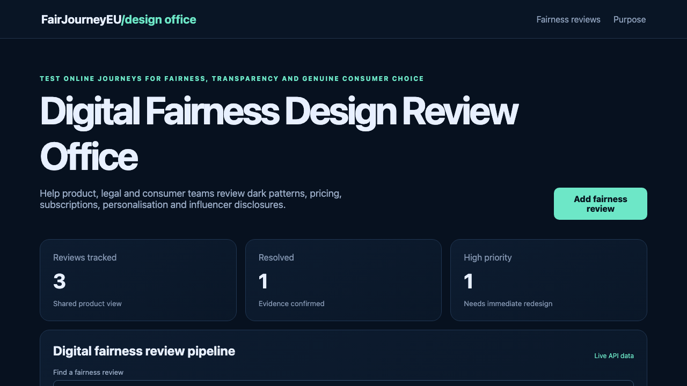

# Digital Fairness Design Review Office

## One-sentence benefit

Help product teams replace manipulative online journeys with fair, transparent consumer choices.

## Live demo

[Watch the workflow](docs/demo.webm).

## Screenshots

## Main features

- Search and sort reviews by journey, pattern, owner or status.
- Create validated reviews with accountable teams and priorities.
- Advance work through draft, review and resolved states.
- Show loading, empty, error and success feedback.
- Use operational and purpose routes responsively.

## Technology used

React, TypeScript, TanStack Query, Wouter, Vite, Spring Boot and Java 21.

## Installation instructions

Install Node.js 22 and Java 21. Run `npm install`, start `cd backend && mvn spring-boot:run`, then run `npm run dev`.

## Commercial licensing/contact

Commercial licensing and integration support are available through the repository contact options.

## Business problem and users

Product, legal, compliance and consumer teams need evidence that pricing, subscriptions, personalisation and marketing journeys enable informed choices.

## Key workflows

Find a journey, create a review, assign an owner, advance it after evidence review and confirm the API result.

## React framework highlights

TanStack Query manages server state, Wouter provides routes and typed forms perform real API writes.

## Java backend highlights

Spring Boot exposes validated list, search, create and update APIs, clear errors, health status and service tests.

## Architecture and state flow

React calls `/api/items`; Java validates requests, applies transitions and returns updated records.

## Accessibility and responsive behaviour

Semantic landmarks, labels, focus states and responsive cards support keyboard and multiple screen sizes.

## Verification commands

Run `npm test`, `npm run lint`, `npm run build`, `cd backend && mvn test` and `cd backend && mvn package`.

## Structure

`src` contains React, `backend` contains Java and `docs` contains inspected media.

## Tradeoffs

In-memory records simplify local use; production needs authentication, persistence and design-system integrations.

## Roadmap

Add pattern libraries, evidence attachments, vulnerable-user reviews, approvals and multilingual reports.
